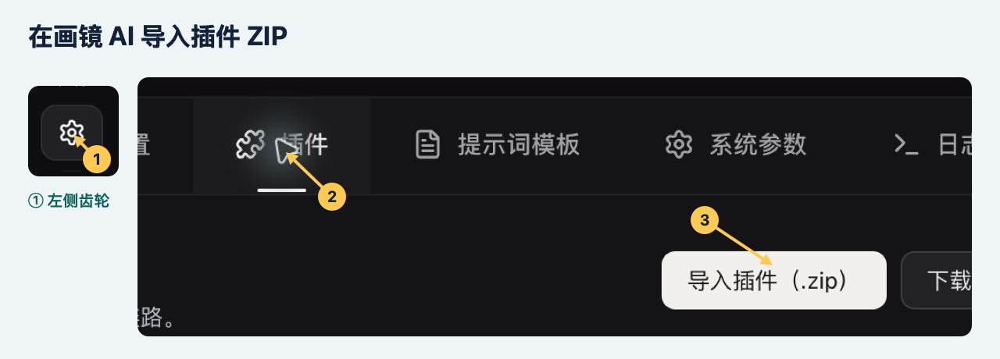
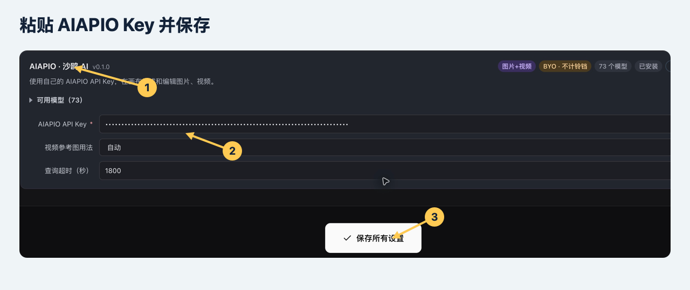
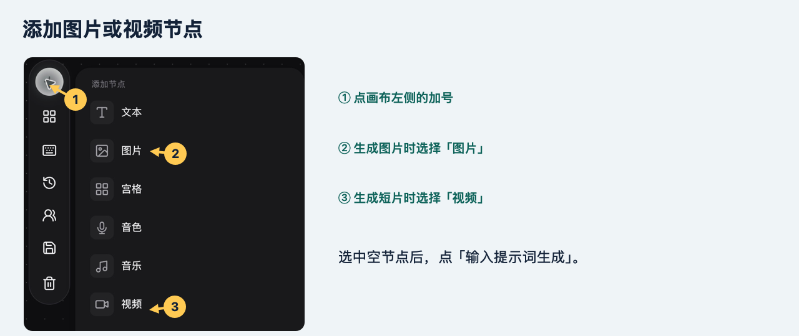
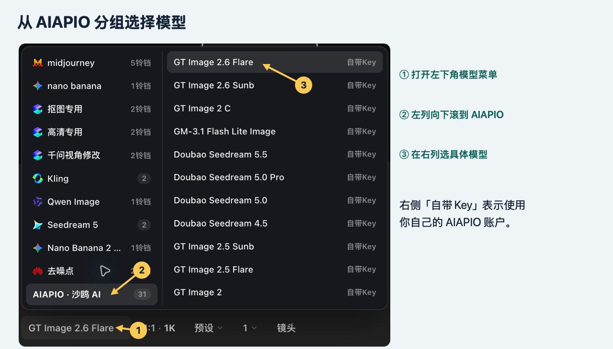
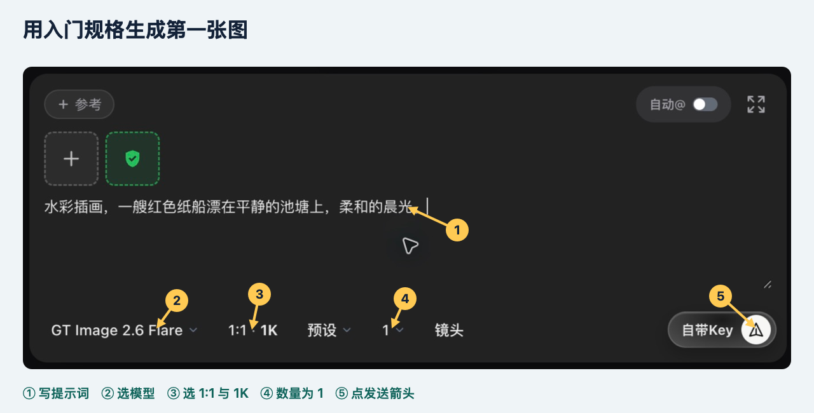
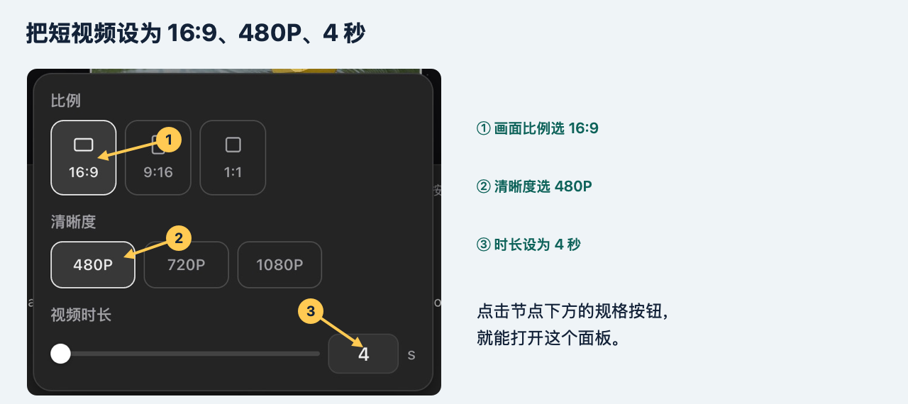
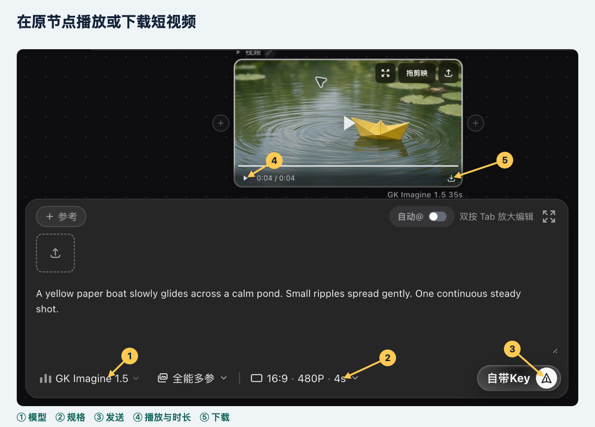
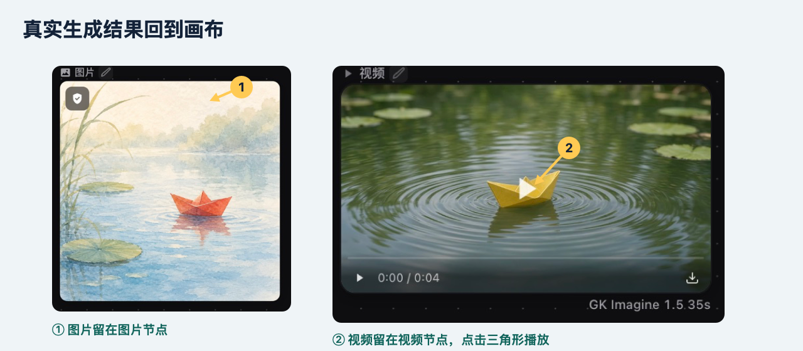

# 画镜 AI × AIAPIO 服务商插件

使用自己的 AIAPIO API Key，在画镜 AI 桌面端的画布生成图片和视频。Windows 和 macOS 共用同一个插件 ZIP。已在两端的画镜 AI 4.5.7 完成真实生成和回传验证。

[GitHub 发行版](https://github.com/simonsxxs/huajing-ai-aiapio-provider/releases/tag/v0.1.0) · [Gitee 发行版](https://gitee.com/simonsxx/huajing-ai-aiapio-provider/releases/tag/v0.1.0)

## 新手图文教程

跟着这九节教程，你可以从安装插件开始，生成第一张图和第一条短视频。截图来自画镜 AI 4.5.7。生成完成后，图片会显示在原来的图片节点，视频可以在原来的视频节点播放。

### 1. 下载正确的文件

1. 先安装并登录画镜 AI 桌面版。已装好画镜 AI 4.5.7 的用户可以直接继续。
2. 打开发行版页面，找到附件 `aiapio-provider-0.1.0.zip`，点击文件名下载。GitHub 的附件位于 **Assets**，Gitee 的附件位于 **发行版**页面。
3. 保留下载的 ZIP，安装时直接选择这个文件。若浏览器自动解压，请重新下载并保留 ZIP。发行版同时提供源码压缩包，导入时请按完整文件名识别插件附件。

[画镜 AI 官方下载](https://ai.lizer.cc/download) · [GitHub 发行版](https://github.com/simonsxxs/huajing-ai-aiapio-provider/releases/tag/v0.1.0) · [Gitee 发行版](https://gitee.com/simonsxx/huajing-ai-aiapio-provider/releases/tag/v0.1.0)

### 2. 获取自己的 AIAPIO API Key

API Key 是 AIAPIO 用来识别你的账户的一串字符。生成时，AIAPIO 根据这把 Key 对应的账户和渠道收费。

1. 登录 AIAPIO，在控制台进入「API 密钥」，打开「管理密钥」页面。
2. 点击创建，名称可写「画镜 AI」。如果已有可用 Key，可以直接使用。
3. 第一次使用可以设置一个小的消费额度，并选价格优先路由。若你启用了接口或模型限制，请确认它允许模型运行时生成、异步任务查询和你要测试的两个模型。模型 ID 分别为 `gt-image-2.6-flare` 和 `gk-imagine-1.5`。只允许传统图片或视频接口的 Key 可能无法调用这个插件使用的统一生成接口。
4. 创建后复制完整 Key，准备粘贴到下一节的密码框。如果网站只在创建时展示完整 Key，请先安全保存。
5. 确保 AIAPIO 账户有可用额度。第一次各试 1 张图、1 条 4 秒视频就能验证链路，当前费用请以自己账户的估价及消费明细为准。

请把完整 Key 当作密码保管。分享截图、报错或日志时，先遮住密钥和带访问权限的文件地址。

[AIAPIO 官网](https://aiapio.com/zh-CN) · [AIAPIO 接口文档](https://aiapio.com/zh-CN/api-docs)

### 3. 导入插件并保存 Key

1. 点击画镜左侧的**齿轮**进入「系统设置」。
2. 在上方标签栏选择**插件**。
3. 点击**导入插件（.zip）**，在文件选择器里打开「下载」或你刚才保存文件的文件夹，再选 `aiapio-provider-0.1.0.zip`。



4. 导入后往下滚动，找到「**AIAPIO · 沙鸥 AI**」卡片。确认有「图片+视频」和「已安装」。
5. 粘贴 AIAPIO Key 到**这张卡片**的「AIAPIO API Key」。视频参考图用法保留「自动」，查询超时先保留默认 1800 秒。这个插件已预设 AIAPIO 接口地址。
6. 滚到页面底部，点击**保存所有设置**，等画镜提示保存成功。换电脑后，需要在那台电脑的画镜中单独保存 Key。



### 4. 进入画布，添加节点

1. 回到项目列表，进入现有画布或点「新建项目」打开一张画布。
2. 点左侧的**加号**。想生成一张图就选「图片」，想生成一条短片就选「视频」。
3. 点击新节点里的「输入提示词生成」，节点下方会展开编辑栏。**节点**就是画布上的一张卡片，提交的结果会回到这张卡片。



如果新节点出现在屏幕外，可使用画布左下方的「适应画布」，或点提示中的「回到节点」。

### 5. 生成第一张图

1. 在图片编辑栏左下角点击当前模型名。模型菜单有两列，先在**左列往下滚**找到「AIAPIO · 沙鸥 AI」，再在右列选 **GT Image 2.6 Flare**。



2. 在提示词区域写下要生成的画面。可以直接复制下面的示例。

   ```text
   水彩插画，一艘红色纸船漂在平静的池塘上，柔和的晨光。
   ```

3. 点模型旁的规格，选 **1:1** 和 **1K**。数量保持 **1**。第一次试跑可只写提示词，参考图留空。
4. 核对模型和规格后，点右下角「自带Key」旁的**发送箭头**一次。
5. 等进度条走完，图片会出现在原节点。把鼠标放到图片上，可看到下载图标。



### 6. 生成第一条 4 秒视频

1. 按第 4 节添加一个「视频」节点。打开模型菜单，在「AIAPIO · 沙鸥 AI」中选 **GK Imagine 1.5**。
2. 在视频提示词区写下主体和动作。第一次可把素材上传框留空，仅用文字生成。

   ```text
   一艘黄色纸船缓慢漂过平静的池塘，水面轻轻泛起涟漪，固定镜头。
   ```

3. 点底部规格按钮，比例选 **16:9**，清晰度选 **480P**，视频时长设 **4 秒**。关闭选项面板后，底栏应显示「16:9 · 480P · 4s」。



4. 点右下角发送箭头一次。看到「AIAPIO 正在生成」后，等视频下载回原节点。
5. 在该节点点击三角形播放。播放器下方会显示 `0:00 / 0:04`。右下角的下载图标可保存视频。





### 7. 添加参考图、首帧和尾帧

- **让图片参考一张现有图**。打开图片节点的「参考」或上传入口，添加图片，写明保留哪些内容和要改哪里。模型需要支持参考图或图片编辑。
- **让视频从一张图开始**。选支持首帧的模型，上传起始图片，再写清人物、物体或镜头要怎么动。「视频参考图用法」保留「自动」时，支持首帧且只添加一张图片的模型会优先使用首帧模式。
- **指定视频的开头和结尾**。先确认模型支持首尾帧。在插件卡片把「视频参考图用法」切到「首尾帧」，保存设置，再按**首帧在前、尾帧在后**的顺序向视频节点添加两张图。测试完成后可以切回「自动」。
- **添加参考视频或音频**。在画镜节点和所选模型都支持时使用。先用短素材测试，注意部分渠道可能把参考素材时长算进费用。

### 8. 遇到报错时怎么处理

| 你看到的情况 | 先做什么 |
| --- | --- |
| 系统设置里找不到插件页签 | 确认使用画镜 AI 桌面端，检查版本。本文实测版本是 4.5.7。 |
| 导入时报压缩包或清单错误 | 重新下载名为 `aiapio-provider-0.1.0.zip` 的发行版附件，直接选 ZIP。 |
| 显示已安装，画布模型里没有 AIAPIO | 回插件卡片确认该 Key 已填并点了底部「保存所有设置」。重新打开节点模型菜单，左列向下滚查看。 |
| 提示 Key 无效或没有模型权限 | 确认粘贴的是完整 AIAPIO Key，并检查它是否启用、到期、用完额度或限制了运行时接口及该模型。 |
| 余额不足或没有可用渠道 | 在 AIAPIO 检查可用余额、Key 额度和该模型的渠道。价格和可用性以你的账户页面为准。 |
| 找不到 480P 或 4 秒 | 核对视频模型是否为 GK Imagine 1.5。不同模型开放的清晰度和时长会不同。 |
| 一直转圈，或提示提交结果未知 | 先去 AIAPIO 查调用记录。有任务编号就先查原任务。确认上一条的状态后再决定是否重跑。 |
| 成功生成，画布提示下载失败 | 凭原任务编号在 AIAPIO 作品库查找成品。可用时使用恢复查询或下载原结果，避免再次提交生成。 |
| 点击取消后账单仍出现任务 | 取消会停止画镜等待，已经提交到 AIAPIO 的任务可能继续。以 AIAPIO 的任务状态及消费明细为准。 |

### 9. 升级、回退和反馈

- **升级**。进入「系统设置 → 插件」，用「导入插件（.zip）」导入同一插件的新版本。检查卡片版本、Key 是否仍在，以及画布里模型能否选择。
- **回退或卸载**。先备份重要成品并保留旧 ZIP。可从插件卡片点击「卸载」，需要回退时再导入上一版 ZIP。
- **反馈**。请附上 Windows 或 macOS、画镜版本、插件版本、模型和规格、报错原文。方便时附上已遮住敏感信息的截图。

## 模型覆盖与安装包校验

首版声明 31 个图片模型和 42 个视频模型。真实验收覆盖 GT Image 2.6 Flare 文生图（1K、1:1）及 GK Imagine 1.5 文生视频（480p、4 秒），各在 Windows 和 macOS 独立生成一次。其余模型完成了模拟测试，实际可用性取决于账户权限和模型渠道。

插件 ZIP 的 SHA-256 为 `bb8a23ecf902ff4a9a328a86ee033d2a9ff4c275622642d65780b7872295b9c1`。

## 从源码构建

构建需要 Python 3.9 或更新版本。测试需要 Node.js 18 或更新版本及 `unzip`。直接在画镜导入插件 ZIP 时，由画镜提供运行环境。

```sh
python3 app/plugin/build.py
node --test app/plugin/handler.test.mjs
```

输出位于 `app/dist/aiapio-provider-0.1.0.zip`。测试使用模拟响应，无需 API Key。

源码采用 [MIT 许可证](LICENSE)。画镜 AI 桌面客户端由其开发方提供。

## 作者

- **作者**：simon，一个不懂代码的AI极客
- **微信交流群**：simonsxxs
- **个人网站**：https://simonsxx.com
- **AI 聚合平台**：https://aiapio.com
- **GitHub**：https://github.com/simonsxxs
- **Gitee**：https://gitee.com/simonsxx
